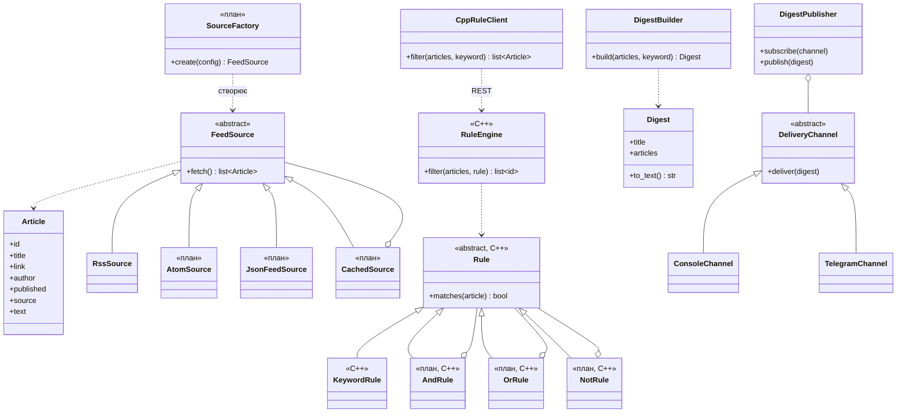
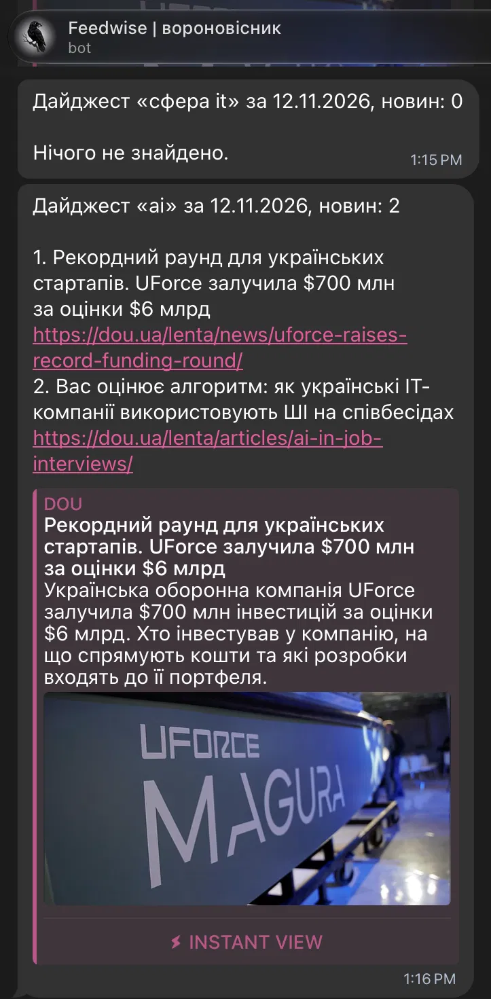

# news-aggregator

Агрегатор новин з правилами фільтрації і дайджестом.

Програма бере новини з RSS, Atom і JSON Feed, фільтрує їх за моїми правилами
(наприклад `(python OR ШІ) AND NOT політика`), прибирає дублікати і надсилає
дайджест у Telegram. Новини зберігаються локально, тому без інтернету
можна дивитись те, що вже завантажилось.

## Основний сценарій

1. Програма бере RSS-стрічку з сайту, наприклад з DOU.
2. Кожну новину перетворює в картку `Article`: назва, посилання, автор, дата, текст.
3. Кожна новина перевіряється правилом, наприклад чи є в ній слово «python». Перевірка на C++.
4. Новини, що підійшли, збираються в одну добірку (дайджест).
5. Дайджест надсилається в Telegram.

Спочатку роблю це для однієї стрічки і одного правила, потім додаю інші формати,
складні правила, дублікати і кеш.

## Функції

- джерела RSS, Atom, JSON Feed
- фільтри за ключовими словами, джерелом, автором і датою, з І / АБО / НЕ
- пошук дублікатів і схожих новин з різних сайтів (шинглування, коефіцієнт Жаккара)
- дайджест за період зі статистикою по джерелах і ключових словах
- доставка в Telegram
- кеш і офлайн-режим
- інтерфейс у терміналі (Textual)

## Аналоги

| | Feedly | Inoreader | Google News |
|---|---|---|---|
| Що це | RSS-читалка | RSS-читалка з правилами | агрегатор від Google |
| Свої правила | приховування за словами | є, з лімітами | немає, тільки теми |
| Дублікати | є | по посиланню або заголовку (Pro) | групує одну подію в Full Coverage |
| Безкоштовно | до 100 джерел | до 150 стрічок | так |

**Feedly** і **Inoreader** це звичайні RSS-читалки: підписуєшся на сайти і читаєш стрічку.
Фільтри там є, але пошук дублікатів і складніші правила в основному платні.
Inoreader шукає дублікати по посиланню або по заголовку, тому якщо назву трохи
змінили, він може не зрозуміти, що це та сама новина.

**Google News** працює інакше: новини підбирає сам Google за твоїми інтересами,
ти тільки обираєш теми. Своє правило типу «python, але без політики» там не задаси.

**Що в мене інакше:**
- дублікати шукаються за текстом новини (шинглування і коефіцієнт Жаккара), а не лише за заголовком;
- правила з І / АБО / НЕ можна задавати які завгодно, без підписки і лімітів;
- дайджест зі статистикою приходить у Telegram;
- новини зберігаються локально, тому програма працює і без інтернету.

## Бібліотеки

Погоджено з викладачем на консультації:

| Для чого | Що використовую |
|---|---|
| Читання RSS / Atom / JSON Feed | своя реалізація, вбудовані `xml.etree`, `json`, `urllib` (feedparser не використовую) |
| Telegram | aiogram |
| Зв'язок C++ і Python | REST API |
| HTTP-сервер на C++ | cpp-httplib |
| JSON у C++ | nlohmann/json |

## Архітектура

Дві програми, які спілкуються через REST API:

- **Python** (основна програма): читає стрічки, робить картки новин, збирає дайджест, надсилає в Telegram.
- **C++** (сервер на cpp-httplib): перевіряє правила, далі тут буде пошук дублікатів.

```
Python                                   C++
RssSource -> Article -> CppRuleClient --POST /filter--> RuleEngine + KeywordRule
                              <-------- {"matched": [...]}
DigestBuilder -> Digest -> DigestPublisher -> ConsoleChannel, TelegramChannel
```

Python надсилає новини і ключове слово в JSON, C++ повертає id новин, які підійшли.

## Діаграма класів

Класи з позначкою «план» ще не написані.



## Патерни

| Патерн | Група | Де | Навіщо |
|---|---|---|---|
| Adapter | структурний | `FeedSource`, `RssSource` | кожен формат стрічки записує новини по-своєму, а решта програми працює тільки з `Article` |
| Observer | поведінковий | `DigestPublisher`, `DeliveryChannel` | дайджест не знає, куди його шлють; канали підписуються і отримують його самі |
| Composite | структурний | `Rule`, `AndRule`, `OrRule`, `NotRule` (план) | правила складаються з інших правил, і з усім деревом працюємо як з одним правилом |
| Decorator | структурний | `CachedSource` (план) | кеш і офлайн-режим додаються поверх будь-якого джерела без його зміни |
| Factory Method | породжувальний | `SourceFactory` (план) | джерело потрібного типу створюється з конфігу, і код, який завантажує новини, не знає про конкретні класи |

Adapter і Observer вже є в коді, Composite, Decorator і Factory Method будуть наступними.
Окрема діаграма для кожного патерну: [docs/patterns.md](docs/patterns.md).

## Ризики

- **Українські літери в C++.** Поки текст переводиться в нижній регістр у Python, а C++ шукає підрядок. Для пошуку дублікатів треба буде розбивати текст на слова в UTF-8 вже в C++.
- **Різні формати стрічок.** У RSS, Atom і JSON Feed по-різному записані дати й автори, а реальні стрічки бувають неповні.
- **Поріг для дублікатів.** Яке значення Жаккара вважати дублікатом, треба підбирати на справжніх новинах.
- **C++-сервер має бути запущений.** Якщо він вимкнений, Python не зможе відфільтрувати новини. Потрібна нормальна помилка.
- **Обмеження Telegram.** Повідомлення до 4096 символів, тому в дайджесті поки максимум 20 новин.
- **Мережа.** Без інтернету стрічка не завантажиться, поки немає кешу.

## Що зараз працює

Мінімальний сценарій: одна RSS-стрічка → картки `Article` → C++ перевіряє ключове слово → дайджест → консоль і Telegram.



## Кілька джерел (план)

Зараз флоу працює з однією стрічкою. У повній версії джерел буде багато, і це працюватиме так.

**1. Список джерел у конфігу.** Не в коді, а у файлі `config/config.yaml`: назва, тип і адреса кожного джерела.

```yaml
sources:
  - name: DOU
    type: rss
    url: https://dou.ua/feed/
  - name: AIN.UA
    type: rss
    url: https://ain.ua/feed/
  - name: CPython releases
    type: atom
    url: https://github.com/python/cpython/releases.atom
  - name: JSON Feed
    type: json
    url: https://www.jsonfeed.org/feed.json
```

**2. Потрібний клас створює фабрика.** `SourceFactory` дивиться на поле `type` і створює `RssSource`, `AtomSource` або `JsonFeedSource`. Щоб додати новий формат, досить нового класу і одного рядка у фабриці (Factory Method).

**3. Джерела завантажуються паралельно.** Сайти качаються одночасно в кількох потоках (`ThreadPoolExecutor`), а не по черзі, тому повільний сайт не затримує інші.

**4. Одне джерело не ламає все.** Якщо сайт не відповідає, помилка пишеться в лог, а новини цього джерела беруться з кешу в SQLite. Решта джерел працює як звичайно.

**5. Усі новини йдуть в один список.** У кожної картки `Article` є поле `source`, тому завжди видно, звідки новина. Далі C++ шукає дублікати між джерелами, а в дайджесті рахується статистика по кожному джерелу.

```
config.yaml -> SourceFactory -> RssSource / AtomSource / JsonFeedSource
            -> паралельне fetch() (з кешем) -> усі Article
            -> C++: правила і дублікати -> дайджест -> Telegram
```

## Далі

- кілька джерел одночасно (паралельне завантаження, Factory Method)
- Atom і JSON Feed
- правила з І / АБО / НЕ на C++ (Composite)
- пошук дублікатів на C++
- кеш і офлайн-режим (Decorator)
- статистика в дайджесті
- інтерфейс у терміналі

## Запуск

Потрібні Python 3.9+, CMake і компілятор C++.

**1. C++-сервер**

```
cd cpp
cmake -S . -B build
cmake --build build
./build/rule_server
```

**2. Python (в іншому вікні терміналу)**

```
cd python
python3 -m venv .venv
source .venv/bin/activate
pip install -r requirements.txt
python -m app.main
```

Налаштування через змінні оточення:

| Змінна | Що це | За замовчуванням |
|---|---|---|
| `FEED_URL` | адреса RSS-стрічки | `https://dou.ua/feed/` |
| `KEYWORD` | ключове слово | `python` |
| `CPP_URL` | адреса C++-сервера | `http://127.0.0.1:8080` |
| `TELEGRAM_BOT_TOKEN` | токен бота | не задано, тоді тільки консоль |
| `TELEGRAM_CHAT_ID` | id чату | не задано |

Наприклад:

```
KEYWORD=ші python -m app.main
```
