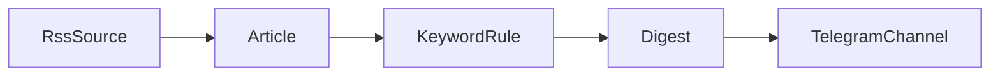

# Основний сценарій

1. **RssSource** завантажує RSS-стрічку з сайту.
2. **Article** картка однієї новини: назва, посилання, автор, дата.
3. **KeywordRule** правило, за яким фільтруємо. Перевіряє одну новину, підходить вона чи ні. Буде на C++.
4. **Digest** збирає всі новини, що підійшли, в одну добірку.
5. **TelegramChannel** надсилає добірку в Telegram.

Спочатку роблю це для однієї RSS-стрічки і одного правила, потім додаю інші формати, складні правила, дублікати і кеш.
