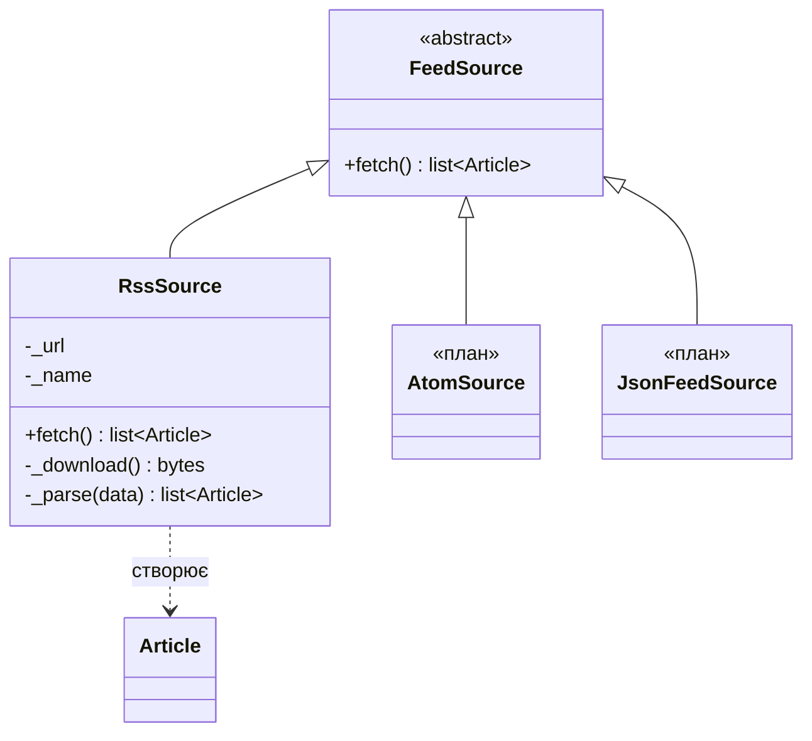
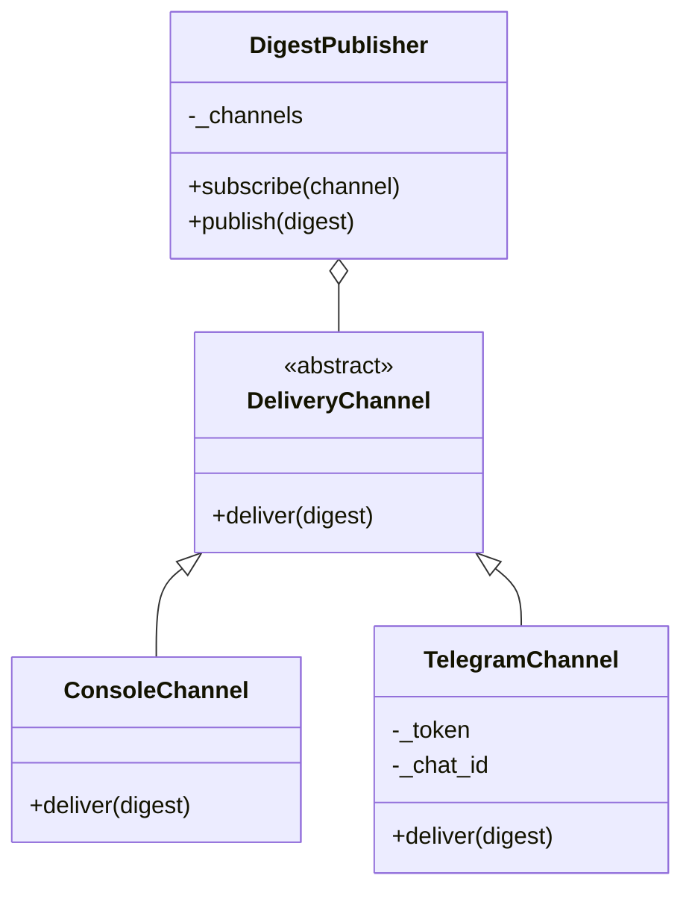
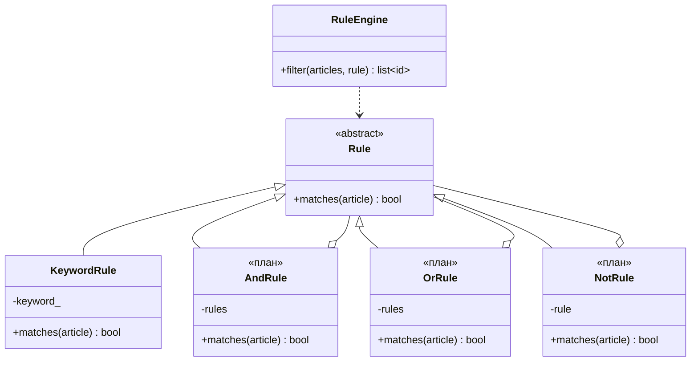
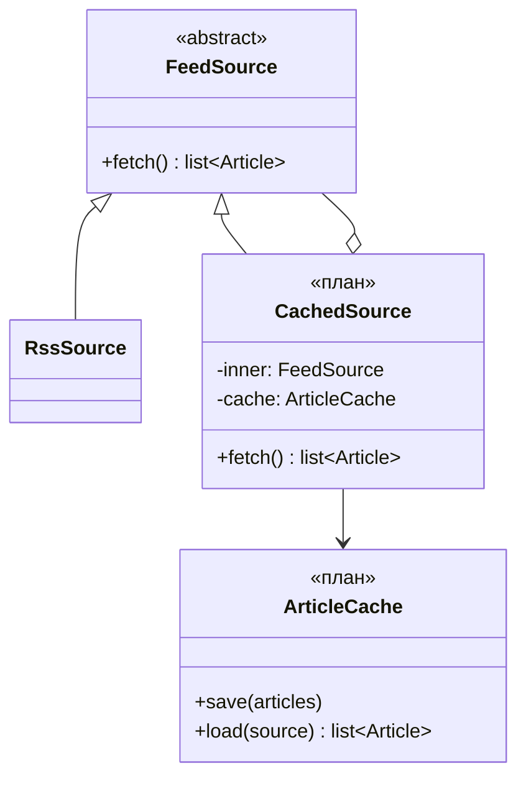

# Патерни

## Adapter (структурний)

Кожен формат стрічки записує новини по-своєму. Адаптер перекладає свій формат у `Article`, тому решта програми не знає, звідки прийшла новина.

## Observer (поведінковий)

Дайджест не знає, куди його шлють. Канали підписуються на `DigestPublisher` і отримують готовий дайджест. Новий канал (email, HTML) додається без зміни інших класів.

## Composite (структурний, план)

Правила І / АБО / НЕ складаються з інших правил. `RuleEngine` працює з будь-яким правилом через `matches`, не знаючи, просте воно чи складене. Зараз є `KeywordRule`, складені правила будуть наступними.

## Decorator (структурний, план)

`CachedSource` обгортає будь-яке джерело: зберігає новини і віддає збережені, коли немає мережі. Саме джерело при цьому не змінюється.

